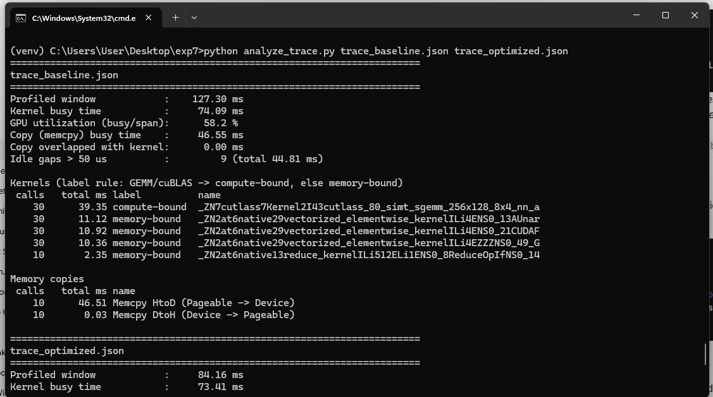
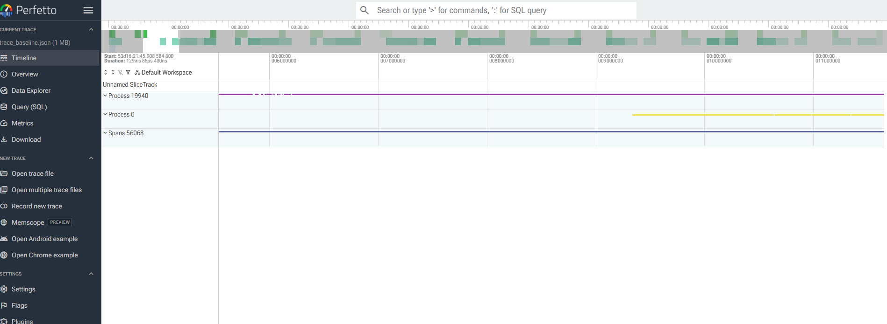
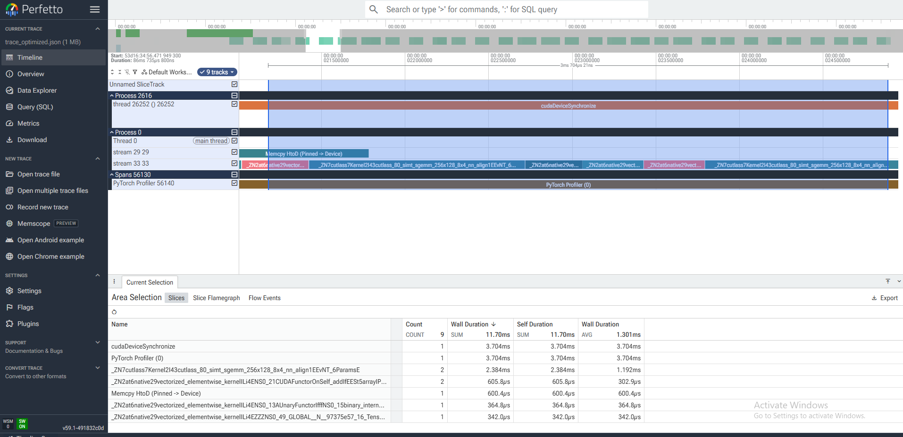

# Experiment 7: Profiling and GPU Utilization

**Institution:** KLE Technological University  
**Hardware:** NVIDIA RTX 4500 Ada Generation (24 GB VRAM, 39.6 TFLOP/s FP32, 432 GB/s Memory Bandwidth)  

## 1. Aim
Profile a GPU workload to identify idle GPU gaps and host-to-device data transfer bottlenecks, classify kernels into compute-bound vs. memory-bound using arithmetic intensity, and improve GPU utilization by overlapping data transfer with computation using **pinned host memory** and **two CUDA streams with double buffering**.

---

## 2. Repository Structure
* `gpu_workload.py` — Runs the workload in `--mode baseline` and `--mode optimized`.
* `analyze_trace.py` — Parses PyTorch Chrome trace JSON files to calculate kernel busy time, GPU utilization %, copy overlap, and idle gaps > 50 µs.
* `smi_baseline.csv` / `smi_optimized.csv` — Live `nvidia-smi` GPU utilization and memory logs.
* `screenchots/` — Terminal execution and Perfetto timeline screenshots.

---

## 3. Setup & Execution Screenshots

### CUDA & PyTorch Environment Setup


### Workload Execution & Output (`gpu_workload.py`)


### Trace Analyzer Output (`analyze_trace.py`)



---

## 4. Perfetto Timeline Visualization (Before vs. After)

### Before Optimization (`trace_baseline.json`)
Host-to-device transfers (`Memcpy HtoD`) from pageable memory and GPU kernels execute strictly serially on the default stream, leaving **9 idle gaps totaling 44.81 ms** across 10 profiled batches (`0.00 ms` overlap).




### After Optimization (`trace_optimized.json`)
Using `.pin_memory()` with two CUDA streams (`copy_s` and `comp_s`) and double buffering, the transfer of batch $i+1$ overlaps concurrently with the kernel execution of batch $i$, hiding **22.67 ms** of copy time behind compute and shrinking idle gaps to **0.59 ms**.




---

## 5. Results & Performance Comparison

### Table 1: GPU Utilization and Run Time (200 Batches, 67 MB/Batch)

| Metric | Baseline | Optimized | Speedup / Change |
| :--- | :---: | :---: | :---: |
| **GPU Model** | NVIDIA RTX 4500 Ada Generation | NVIDIA RTX 4500 Ada Generation | — |
| **Total Time (s)** | `2.319 s` | `1.508 s` | **1.54x faster** (`-0.811 s`) |
| **Time per Batch (ms)** | `11.60 ms` | `7.54 ms` | **`-4.06 ms`** (`-35.0%`) |
| **Throughput (batches/s)** | `86.2 batches/s` | `132.6 batches/s` | **`+53.8%`** |
| **Profiled Window (10 batches)** | `127.30 ms` | `84.16 ms` | **`-43.14 ms`** (`1.51x` faster) |
| **Kernel Busy / Window (%)** | `58.2 %` (`74.09 ms`) | `87.2 %` (`73.41 ms`) | **`+29.0` percentage points** |
| **Idle Gaps > 50 µs (count / ms)** | `9` gaps (`44.81 ms`) | `9` gaps (`0.59 ms`) | **`-44.22 ms`** (`98.7%` gap reduction) |
| **Copy Overlapped with Kernels** | `0.00 ms` | `22.67 ms` (of `28.74 ms`) | **`78.9%` of copy hidden** |
| **Host-to-Device Copy Type** | Pageable (`46.51 ms` / `4.65 ms` per batch) | Pinned (`28.71 ms` / `2.87 ms` per batch) | **`1.62x` faster H2D copy** |
| **Checksum** | `4.198830e+09` | `4.198830e+09` | **Identical** |

---

### Table 2: Kernel Classification (Arithmetic Intensity vs. Ridge Point)

**NVIDIA RTX 4500 Ada Ridge Point Calculation:**
$$\text{Ridge Point} = \frac{\text{Peak FP32 FLOP/s}}{\text{Peak Memory Bandwidth}} = \frac{39,600\text{ GFLOP/s}}{432\text{ GB/s}} \approx \mathbf{91.7\text{ FLOP/byte}}$$

| Kernel (Profiler Name) | Calls | Baseline (ms) | Optimized (ms) | AI (FLOP/B) | Classification |
| :--- | :---: | :---: | :---: | :---: | :--- |
| `cutlass_80_simt_sgemm` (GEMM) | 30 | `39.35` | `38.91` | ~249 | **Compute-bound** ($\text{AI} > 91.7$) |
| `vectorized_elementwise_kernel` (ReLU) | 30 | `11.12` | `11.17` | 0.125 | **Memory-bound** ($\text{AI} < 91.7$) |
| `vectorized_elementwise_kernel` (mul) | 30 | `10.92` | `10.89` | 0.125 | **Memory-bound** ($\text{AI} < 91.7$) |
| `vectorized_elementwise_kernel` (add) | 30 | `10.36` | `10.56` | 0.125 | **Memory-bound** ($\text{AI} < 91.7$) |
| `reduce_kernel` (sum over columns) | 10 | `2.35` | `1.89` | 0.25 | **Memory-bound** ($\text{AI} < 91.7$) |
| **Total Kernel Time** | — | **`74.10`** | **`73.42`** | — | — |

---

## 6. Bottlenecks Identified & Fixes Applied


| # | Bottleneck Found (Evidence) | Fix Applied | Result |
| :---: | :--- | :--- | :--- |
| **1** | **Pageable host memory:** `Memcpy HtoD (Pageable -> Device)` took `46.51 ms` (`4.65 ms/batch`) due to driver staging buffer copies. | Allocated host batches and output buffer in page-locked memory using `.pin_memory()`. | `Memcpy HtoD (Pinned -> Device)` dropped to `28.71 ms` (`2.87 ms/batch`, **1.62x faster**). |
| **2** | **Serial copy and compute:** Default single stream forced kernels to wait for H2D transfers, causing `44.81 ms` of idle gaps (`58.2%` utilization). | Used two CUDA streams (`copy_s`, `comp_s`) with double buffering (`buf[0]`, `buf[1]`) and events (`copied`, `freed`). | Overlapped **`22.67 ms`** of copy with compute, cutting idle gaps to **`0.59 ms`** and raising utilization to **`87.2%`**. |
| **3** | **Blocking `.cpu()` synchronization per batch:** Host waited for D2H completion on every batch before queuing the next batch. | Replaced per-batch `.cpu()` with `out_host[i].copy_(r, non_blocking=True)` and a single `torch.cuda.synchronize()` at the end. | Total runtime for 200 batches dropped from **`2.319 s` to `1.508 s`** (**1.54x speedup**). |
| **4** | **Unfused memory-bound element-wise kernels:** ReLU, `mul_`, and `add_` spent `32.62 ms` (~44% of kernel time) repeatedly reading/writing the 67 MB tensor. | Noted as further work (kernel fusion via `torch.compile`). | Identified for future optimization. |


## 2. Repository Structure

```text
PGC-Experiment-07_Profiling-_and_GPU_Utilization/
├── screenchots/
│   ├── UI_trace_baseline_output.png
│   ├── Ui_trace optimised_output.png
│   ├── analyze trace.png
│   ├── cuda and pytorch setup.png
│   ├── gpu workload ouput.png
│   ├── gpu workload.png
│   ├── readme.md
│   ├── trace optimised_output.png
│   ├── trace_baselion_output.png
│   ├── ui_optimised_after.png
│   └── ui_trace baselion_after.png
├── README.md
├── analyze_trace.py
├── gpu_workload.py
├── smi_baseline.csv
├── smi_optimized.csv
├── trace_baseline.json
└── trace_optimized.json
